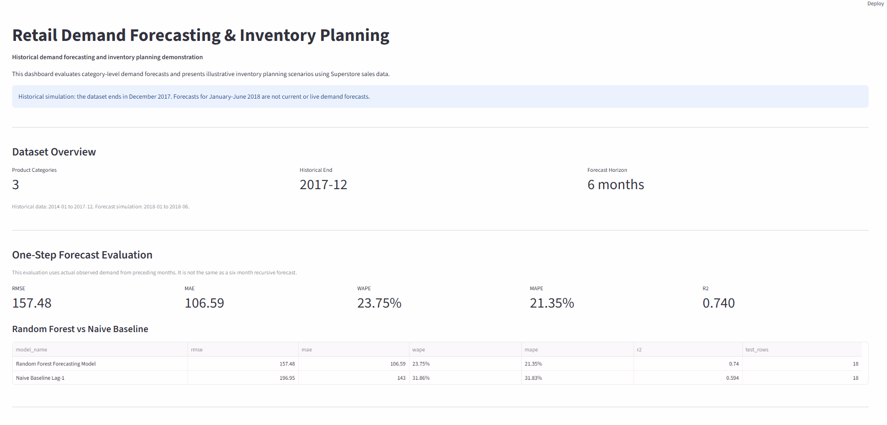
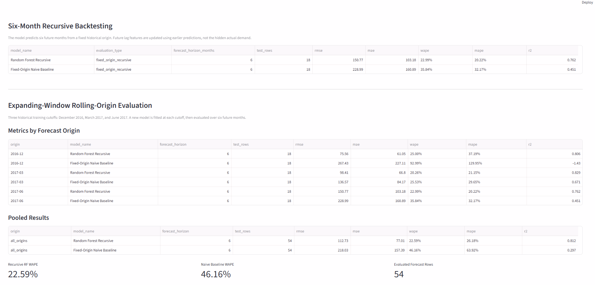
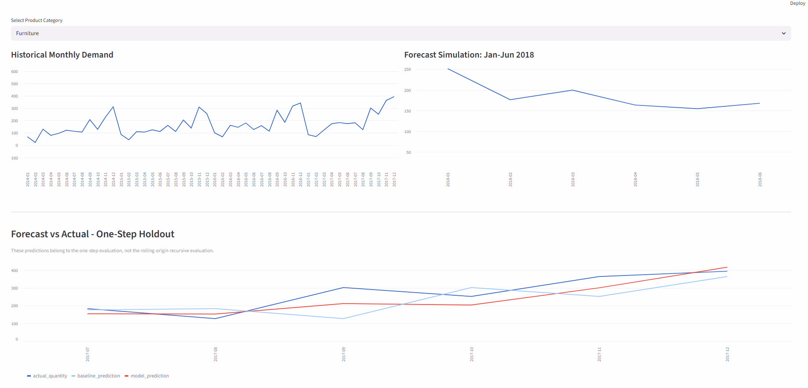
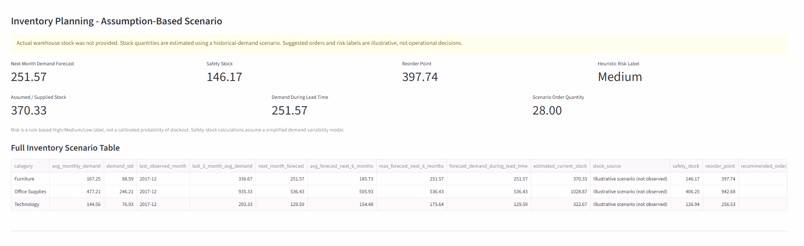

# Retail Demand Forecasting & Inventory Planning

An end-to-end Python data science project that forecasts **monthly retail demand by product category**, evaluates **multi-step forecasts without future-target leakage**, and translates forecasts into **illustrative inventory-planning scenarios**.

> **Historical simulation, not a current forecast:** The Superstore dataset covers **January 2014–December 2017**. The six-month forecasts shown here are for **January–June 2018**, generated as though the analysis were performed at the end of 2017. No 2026 demand or live inventory is claimed.

## Highlights

- Aggregates 9,994 sales records into monthly demand for three categories: Furniture, Office Supplies, and Technology.
- Builds category-specific lag and rolling-mean features without using the current month's target.
- Trains a scikit-learn Random Forest regression pipeline and compares it with simple baselines.
- Separates **one-step-ahead evaluation** (observed history updated monthly) from **six-step recursive forecasting** (future lags built from earlier predictions).
- Uses **three expanding-window rolling-origin evaluations**, with a separate model fitted at each cutoff.
- Fits the final forecasting model on all available historical training examples for the 2018 forecast simulation.
- Generates safety-stock, reorder-point, and order-quantity estimates, with explicit warnings when stock is assumed rather than observed.
- Includes a Streamlit dashboard, saved charts, CSV reports, and **12 automated tests**.

## Dataset and forecast scope

| Item | Value |
|---|---|
| Dataset | Superstore sales transactions |
| Raw records | 9,994 |
| Original columns | 21 |
| Historical period | January 2014–December 2017 |
| Product categories | 3 |
| Monthly category observations | 144 (48 months × 3 categories) |
| Rows after three-month lag feature construction | 135 (45 per category) |
| Forecast granularity | Category × month |
| Forecast horizon | 6 months |

The raw dataset is expected at `data/raw/superstore.csv`. Raw and processed datasets are excluded from version control by `.gitignore`, so **a fresh clone requires the user to supply the dataset** before running the pipeline.

This is category-level *sales quantity* forecasting, not SKU-level inventory demand. The raw data has no inventory-position or replenishment-event history.

## Project structure

```text
retail-demand-forecasting/
|-- app/
|   `-- streamlit_app.py
|-- data/
|   |-- raw/                       # Not tracked
|   `-- processed/                 # Generated; not tracked
|-- models/                        # Generated; not tracked
|-- results/
|   |-- figures/
|   |-- forecast_metrics.csv
|   |-- category_forecast_metrics.csv
|   |-- forecast_vs_actual.csv
|   |-- recursive_backtest_predictions.csv
|   |-- recursive_backtest_metrics.csv
|   |-- recursive_backtest_category_metrics.csv
|   |-- rolling_origin_predictions.csv
|   |-- rolling_origin_metrics.csv
|   |-- rolling_origin_summary.csv
|   |-- demand_forecast.csv
|   `-- inventory_recommendations.csv
|-- screenshots/
|-- src/
|   |-- config.py
|   |-- data_loader.py
|   |-- preprocessing.py
|   |-- forecasting.py
|   |-- backtesting.py
|   |-- rolling_origin.py
|   |-- inventory.py
|   `-- visualization.py
|-- tests/
|   |-- test_lag_features.py
|   |-- test_backtesting.py
|   |-- test_rolling_origin.py
|   `-- test_inventory.py
|-- main.py
|-- requirements.txt
|-- .gitignore
`-- README.md
```

## Methodology

### 1. Data preparation

Order-level records are cleaned and aggregated by category and calendar month. The prediction target is `total_quantity`; each model row also includes `category`, `year`, and `month`.

### 2. Leakage-aware feature engineering

The forecasting pipeline uses:

```text
category, year, month, lag_1, lag_2, lag_3, rolling_mean_3
```

Lag features are computed **within each category**. `rolling_mean_3` uses the **three preceding months**, not the month being predicted.

### 3. Forecasting model

- Estimator: `RandomForestRegressor` (`n_estimators=300`, `max_depth=8`, `random_state=42`).
- Preprocessing: numeric scaling and one-hot encoding of category through a scikit-learn pipeline.
- Target: monthly `total_quantity`.
- Final fitted model: `models/demand_forecasting_model.joblib` (generated locally, not tracked in Git).

The model and hyperparameters are a project baseline, **not a claim of exhaustive tuning or production readiness**.

### 4. Two different evaluation settings

**One-step holdout:** For the final six historical months per category (July–December 2017), each prediction may use **actual observed earlier-month demand** to construct its features. This represents a process where demand observations are updated each month.

**Fixed-origin recursive holdout:** From the June 2017 origin, the model predicts July–December 2017 without accessing actual future demand while creating later forecast lags. Earlier **predictions**, not hidden actuals, feed the next step. The baseline repeats the last observed demand at the origin.

The one-step and recursive scores measure different operational questions and should **not** be presented as directly interchangeable.

## Evaluation results

### One-step holdout (18 category-month predictions)

| Model | RMSE ↓ | MAE ↓ | WAPE ↓ | MAPE ↓ | R² ↑ |
|---|---:|---:|---:|---:|---:|
| Random Forest | **157.48** | **106.59** | **23.75%** | **21.35%** | **0.740** |
| Previous-month naive baseline | 196.95 | 143.00 | 31.86% | 31.83% | 0.594 |

### Six-month fixed-origin recursive holdout (origin: June 2017)

| Model | RMSE ↓ | MAE ↓ | WAPE ↓ | MAPE ↓ | R² ↑ |
|---|---:|---:|---:|---:|---:|
| Random Forest recursive | **150.77** | **103.18** | **22.99%** | **20.22%** | **0.762** |
| Fixed-origin naive baseline | 228.99 | 160.89 | 35.84% | 32.17% | 0.451 |

### Expanding-window rolling-origin evaluation

Three models are trained separately using data available **at each origin**. Each origin tests the next six months across three categories (18 predictions per origin).

| Training cutoff | Forecast window | RF RMSE ↓ | Baseline RMSE ↓ | RF WAPE ↓ |
|---|---|---:|---:|---:|
| 2016-12 | Jan–Jun 2017 | **75.56** | 267.43 | 25.00% |
| 2017-03 | Apr–Sep 2017 | **98.41** | 136.57 | 20.26% |
| 2017-06 | Jul–Dec 2017 | **150.77** | 228.99 | 22.99% |

**Pooled metrics (54 forecast rows):**

| Model | RMSE ↓ | MAE ↓ | WAPE ↓ | MAPE ↓ | R² ↑ |
|---|---:|---:|---:|---:|---:|
| Random Forest recursive | **112.73** | **77.01** | **22.59%** | **26.18%** | **0.812** |
| Fixed-origin naive baseline | 218.03 | 157.39 | 46.16% | 63.92% | 0.297 |

The pooled Random Forest RMSE is approximately **48.3% lower** than that of this fixed-origin naive baseline. These results are descriptive: the windows **overlap**, so the 54 rows are **not 54 independent calendar-month observations**. More origins, seasonal baselines, and additional datasets would be necessary for stronger generalization claims.

The baseline is deliberately simple and not necessarily the strongest possible forecaster. Relative performance could change under seasonal-naive or other benchmarks.

## Six-month future forecast simulation

After the historical evaluation, a new model is fitted using **all 135 available lagged rows** (through December 2017). It recursively generates forecasts for **January–June 2018**.

| Category | January 2018 forecast | Average forecast, Jan–Jun 2018 |
|---|---:|---:|
| Furniture | 251.57 | 185.73 |
| Office Supplies | 536.43 | 505.93 |
| Technology | 129.59 | 154.48 |

Full category-month predictions: [`results/demand_forecast.csv`](results/demand_forecast.csv).

These are **historical forecast-simulation outputs** based on a dataset ending in 2017. They are not forecasts from today's date.

## Inventory planning: explicit assumptions

The inventory module converts the forecasts to a **category-level planning scenario**. With the default `lead_time_months=1.0` and `service_level_z=1.65`:

```text
Lead-time demand = sum of forecasted demand over the lead time
Safety stock = z * historical monthly demand std * sqrt(lead time in months)
Reorder point = lead-time forecast demand + safety stock
Suggested order quantity = ceil(max(reorder point - assumed/provided stock, 0))
```

Fractional lead times prorate the forecast for the final partial month. The safety-stock equation assumes approximately independent monthly demand variability and uses historical sample standard deviation as a proxy; it is **not** a calibrated guarantee of service level.

**Important stock-data distinction:**

- **Default:** `estimated_current_stock = 1.10 × average historical demand over the last three months`. This is **synthetic scenario stock**, not an observed warehouse balance.
- **Optional:** `calculate_inventory_recommendations(...)` accepts a `current_stock_by_category` mapping for stock supplied by the caller.
- `stock_source` records which type of stock input was used.
- `stockout_risk` is a **heuristic High/Medium/Low label**, not a modeled stockout probability. Its interpretation is recorded in `risk_interpretation`.

### Example output using illustrative stock (one-month lead time)

| Category | Forecast during lead time | Assumed stock | Safety stock | Reorder point | Suggested units | Scenario label |
|---|---:|---:|---:|---:|---:|---|
| Furniture | 251.57 | 370.33 | 146.17 | 397.74 | **28** | Medium |
| Office Supplies | 536.43 | 1,028.87 | 406.25 | 942.68 | 0 | Low |
| Technology | 129.59 | 322.67 | 126.94 | 256.53 | 0 | Low |

These quantities **must not be interpreted as operational purchase orders**. The dataset does not include actual on-hand inventory, outstanding purchase orders, reservations, supplier constraints, holding/shortage costs, or verified lead-time variability. This is a **reorder-point demonstration**, not a fully optimized inventory policy.

## Visualizations and dashboard

The project saves the following charts:

- [Historical monthly demand](results/figures/historical_monthly_demand.png)
- [Forecasted demand, 2018 simulation](results/figures/forecasted_demand.png)
- [Illustrative inventory-risk scenario](results/figures/stockout_risk_distribution.png)
- [Furniture: forecast vs actual](results/figures/forecast_vs_actual_furniture.png)
- [Office Supplies: forecast vs actual](results/figures/forecast_vs_actual_office_supplies.png)
- [Technology: forecast vs actual](results/figures/forecast_vs_actual_technology.png)

The inventory-risk chart explicitly labels illustrative stock assumptions and heuristic risk labels. Forecast-vs-actual charts refer to the **one-step holdout**, not the pooled rolling-origin evaluation.

The Streamlit dashboard can be launched with:

```bash
streamlit run app/streamlit_app.py
```

### Dashboard screenshots

These screenshots show the updated Streamlit dashboard using the historical Superstore simulation (not live demand forecasts).

**1. Dashboard overview and one-step evaluation**



**2. Recursive and rolling-origin model validation**



**3. Demand analysis and forecast-versus-actual charts**



**4. Inventory planning with clearly labeled illustrative stock**



The inventory illustration uses **assumed stock**, not an observed warehouse balance. The heuristic risk labels are not calibrated stockout probabilities.

## Reproduce the results (Windows)

1. Clone the repository and enter the project directory:

   ```cmd
   git clone https://github.com/Zahra-ziaee/retail-demand-forecasting.git
   cd retail-demand-forecasting
   ```

2. Create and activate a virtual environment in **Command Prompt**:

   ```cmd
   python -m venv .venv
   .venv\Scripts\activate.bat
   ```

3. Install the dependencies:

   ```cmd
   python -m pip install -r requirements.txt
   ```

4. Place the Superstore CSV at `data/raw/superstore.csv`.

5. Generate the data, final model, six-month forecast, inventory scenario, and charts:

   ```cmd
   python main.py
   ```

6. Run the three-origin recursive backtest:

   ```cmd
   python -m src.rolling_origin
   ```

7. Run the automated test suite **after generating the reports**, since the rolling-origin report tests inspect saved CSV files:

   ```cmd
   python -m unittest discover -s tests -p "test_*.py" -v
   ```

   Expected result on the validated project version: **12 tests passed**.

8. Optionally run the dashboard:

   ```cmd
   streamlit run app/streamlit_app.py
   ```

## Main generated outputs

| File | Contents |
|---|---|
| `results/forecast_metrics.csv` | One-step holdout comparison |
| `results/category_forecast_metrics.csv` | One-step metrics by category |
| `results/forecast_vs_actual.csv` | One-step prediction records |
| `results/recursive_backtest_predictions.csv` | Six-month fixed-origin predictions |
| `results/recursive_backtest_metrics.csv` | Six-month recursive overall scores |
| `results/recursive_backtest_category_metrics.csv` | Recursive scores by category |
| `results/rolling_origin_predictions.csv` | Predictions from all three origins |
| `results/rolling_origin_metrics.csv` | Per-origin performance comparison |
| `results/rolling_origin_summary.csv` | Pooled scores across origins |
| `results/demand_forecast.csv` | Six-month 2018 forecast simulation |
| `results/inventory_recommendations.csv` | Explicitly labeled inventory scenarios |

## Tests and quality checks

The `unittest` suite contains 12 tests covering:

- Category-specific lag and rolling feature correctness.
- No use of the current target in lagged features.
- Recursive updates using **predicted**, not actual future, values.
- Detection of nonconsecutive forecast months.
- Rolling-origin windows and the fixed-origin naive baseline.
- Independent recalculation of saved error metrics.
- Inventory formulas, illustrative vs provided stock, fractional lead times, and invalid inputs.

These tests are helpful checks, not a complete proof that every data issue or deployment condition is covered.

## Limitations and next steps

- **Small dataset:** 48 historical months per category and three categories only.
- **Limited baselines:** Add seasonal-naive forecasting and stronger statistical or ML comparisons.
- **Overlapping backtests:** Avoid treating pooled rows as independent experiments; explore additional nonoverlapping origins.
- **Forecast uncertainty:** The model produces point forecasts, not calibrated prediction intervals.
- **Random Forest extrapolation:** Performance beyond the historical range may be limited, especially for future calendar years.
- **Not real inventory optimization:** Incorporate actual inventory positions, purchase orders, lead-time uncertainty, capacity, procurement costs, and service-level validation.
- **Scope:** Extend evaluation to SKU and regional levels if sufficiently reliable data becomes available.
- **Dashboard:** Check that displayed labels and screenshots remain consistent with the new illustrative-inventory assumptions.

## Technology

Python, pandas, NumPy, scikit-learn, Random Forest, Matplotlib, Streamlit, joblib, Git, GitHub, and `unittest`.

## Résumé summary

> Built a leakage-aware category-level retail demand forecasting pipeline using Random Forest, six-month recursive forecasting, and three expanding-window backtests. Across 54 overlapping forecast rows, achieved **22.59% WAPE versus 46.16%** for a fixed-origin naive baseline, with **12 automated tests**. Developed clearly labeled illustrative safety-stock and reorder-point scenarios and a Streamlit reporting dashboard.

## Author

**Zahra Ziaee** · [GitHub](https://github.com/Zahra-ziaee)
